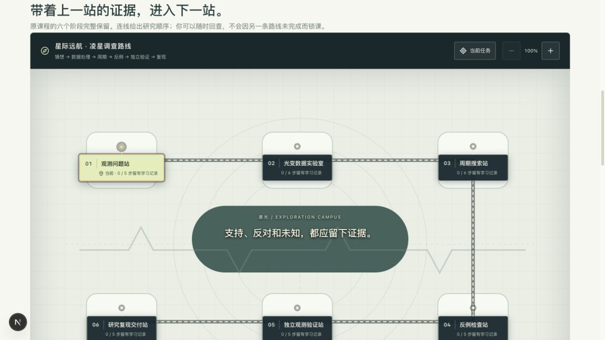

# Lightkurve 整合验收 — 2026-10-29

本批补齐上一轮剩余的 32 个节点，按原六阶段接入星际远航。原火星车路线的 85 个来源节点、8 个任务站、88 张任务单保持不变；两条路线分别计算主线进度，同一份任务存储不会因切换而被裁掉。

## 已检查

- `integration-verification.json`：32/32 唯一覆盖、依赖、登录回跳、原路线对象一致、旧记录恢复、同编号跨课程隔离及来源散列。
- `curriculum-verification.json`、`operations-verification.json`：117 个来源节点与 120 张任务单；62 步火星车路线和 32 步凌星路线；证据、自检、计时、损坏数据与身份隔离回归。
- `node scripts/verify-learning-record-session.cjs`：通过。
- 本批新增与改动的路线/Lightkurve TypeScript 文件定向 ESLint：通过。
- 浏览器实测：六站地图和任务单；M23 自检与证据刷新/切换恢复；原正文富媒体入口；原讲课浮窗翻页；M01 90° / 1.44% 实验产物关联和刷新恢复；M24 冻结→M25 揭盲→首次结果保留，刷新前后作业 JSON 完全一致。
- 下载的原实践包与课程源 SHA-256 一致：`5bf36f81fe4f8a040e2929db4c7fb727f4e644a00cee26ff2c897c611b8bce74`。
- 正式 M24 路由未登录时保留 `/learn/lightkurve-transit-detective/M24?mission=space` 回跳地址。

## 统一课堂与兼容

正式路由和本地验收都使用 `LightkurveCourseLesson`，内部复用 `CourseContentView`、`CourseMediaContext`、`LessonSlidesProvider` 和既有学习记录组件。旧预览组件仅作为兼容导出，不再提供按动画/幻灯片/作业分类的独立课堂 tabs。

`lightkurve-notebook`、`lightkurve-delivery`、quiz/exam activity、原模块 ID、`SHA256(JSON.stringify({record, assignment})).slice(0,32)` 记录版本和冻结存储 key 保持一致。课程源未改写。普通实验的已关联操作数据在原作业处恢复；M24/M25 还恢复模拟器内的冻结配置和首次结果。没有承诺为所有普通沙盒恢复未保存的临时滑块位置。

媒体消息继续检查来源 iframe window 和既有消息结构；保留观测在冻结保存并读回后才能请求。正式课程文件、实践包与 Q4 使用原有登录/已加入项目文件 API，不向 iframe、下载链接或图片 URL 写入 token。

## 未完成的联机/发布验收

本地课程树 API `127.0.0.1:18820/api/library/projects/lightkurve-transit-detective/tree` 当前返回 HTTP 500 / `internal`，因此正式账号的课程文件读取、服务器保存和账号恢复还不能宣称端到端通过。浏览器验收使用原始课程文件和同一个正式课堂组件，未模拟登录或写入学生账号。

手机视口能力未生效（请求 390×844，实际仍为 1280 宽），未将手机验收计为通过；临时视口设置已复位。被检查的幻灯片显示“暂无语音”，未声称测试过音频。

完整 TypeScript 检查仍有基线的 6 个错误，详见 `typecheck.txt`。slide-demo 两处 TS2352 与 course-content-view 四处 TS2554 的相关代码在本批未改变；后者因新增导入/链接适配发生四行偏移。本批定向 lint 通过，没有新的类型错误；没有声称生产构建、部署或合并完成。

## 复现

```sh
python3 scripts/build-lightkurve-mission.py /absolute/path/to/lightkurve-transit-detective
LIGHTKURVE_SOURCE=/absolute/path/to/lightkurve-transit-detective node scripts/tests/lightkurve-mission.cjs
node scripts/tests/space-mission-curriculum.cjs
node scripts/tests/space-mission-operations.cjs
node scripts/verify-learning-record-session.cjs
python3 scripts/prepare-lightkurve-classroom-check.py /absolute/path/to/lightkurve-transit-detective
```

最后一步生成可移除的 `src/app/verification-lightkurve-local` 开发夹具（仅开发模式、loopback 主机可访问）。本次验收后已删除生成目录，只提交复现脚本。路线预览：`http://127.0.0.1:4002/mission/space?route=transit`。学习数据为端口 4002 下本次验收创建的匿名数据，不代表学生成果或科学验收。


