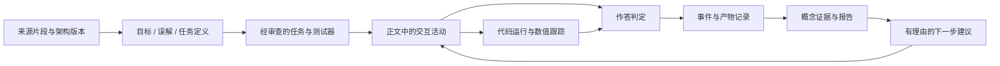

# Transformer 交互学习工坊：设计草案

日期：2026-10-22。状态：供讨论的产品与技术方案，尚未实现、试教或验证学习效果。本文中的时间、题量和合格规则均为初始设计；示例学习记录为虚构演示。

## 1. 目标与推荐路线

让学习者通过构造、预测、实验、编程、纠错和迁移任务，理解并实现 Transformer 的关键计算。每一个“学会了”的判断，都能回到具体作答、运行结果或解释证据。材料、交互、代码和报告围绕同一个概念连接起来。

面向会基本 Python、接触过矩阵的专业人士。入门诊断覆盖形状、矩阵乘法、概率归一化与 Python 索引；薄弱者进入短补习任务，熟悉者可以用诊断结果跳过。专业背景不等于已经掌握所有前置知识。

| 方案 | 长处 | 局限 | 定位 |
| --- | --- | --- | --- |
| 有任务目标的交互工坊 | 概念、操作与验收一一对应，能解释学习路径 | 需要逐题设计交互与判定器 | 推荐作为主线 |
| 自由探索的大模型可视化 | 可以自由修改输入、观察内部计算 | 容易看过很多现象却无法判断理解程度 | 作为探索模式 |
| 对话式 AI 导师 | 可追问、解释代码错误、提供不同表述 | 自由对话难以稳定覆盖目标与判分 | 作为有边界的辅助解释 |

推荐主线为“任务工坊 + 自由实验 + 可选导师”。第一版使用可解释的任务规则，不依赖模型自由决定学习者能否合格。

学习闭环：资料片段 → 背景解释 → 预测 → 操作或构造 → 运行与观察 → 解释差异 → 新情境验证 → 概念状态与下一步建议。各任务按需要选用其中的环节，不强制套同一模板。

## 2. 从资料到可执行学习任务

资料库不是一个长链接清单。每个来源要绑定到概念、具体段落或片段、一道任务，以及该资料支持的事实。

| 资料 | 拟承担的作用 | 索引策略 |
| --- | --- | --- |
| [Attention Is All You Need](https://arxiv.org/abs/1706.03762) | 原始架构与数学定义 | 按 §3.1–3.5 等章节建立锚点；标明原始 encoder–decoder 语境 |
| [Harvard NLP: Annotated Transformer](https://github.com/harvardnlp/annotated-transformer) | 带注释的实现参考，连接公式与代码 | 按函数和固定 commit 建索引，逐项核对与课程选定变体的差异 |
| [3Blue1Brown: Attention in transformers](https://www.3blue1brown.com/lessons/attention/) | 向量、投影与注意力的几何直觉 | 对应几何任务；视频片段时间经核验后写入 |
| [Andrej Karpathy: Let's build GPT](https://www.youtube.com/watch?v=kCc8FmEb1nY) | 从实现进入 decoder-only 模型 | 按代码主题建立 YouTube 索引，定位时间须核对视频或字幕 |
| [Transformer Explainer](https://poloclub.github.io/transformer-explainer/) | 参考输入变化与内部数值联动的交互方式 | 作为探索参考，评测任务与学习报告另行设计 |

以上已核对官方来源入口；没有完成逐段视频时间标注，也没有逐行审查参考实现。本草案不提供未经核实的时间戳。Harvard 博客正文读取受页面大小限制，已确认其官方仓库，实际选材时还需读取对应代码。

每个任务保存 `source_id / locator / checked_at / source_revision / architecture_variant`。视频不能嵌入时提供原站入口与原创文字解释；不把整篇论文、博客或整段字幕复制为课程正文。引用实现需遵循许可证。

编制流程：选定学习目标 → 对齐多个资料的定义 → 写出常见误解与反例 → 选择能暴露误解的交互 → 编写题目、参考实现和数值测试 → 人工审查 → 小范围试学。AI 可辅助提取和草拟，来源内容不能直接生成未经检查的判分标准。

## 3. 课程地图与不同概念的表达方式

总体地图展示原论文的 encoder–decoder；首次动手聚焦共用的注意力计算。后续以明确标识的 decoder-only 分支学习 GPT 式生成。每道架构题必须写明变体：原论文的 Post-LN 与现代常见的 Pre-LN 分别作图、分别判分，避免让学习者把不同结构拼成一个“标准答案”。

| 学习站 | 需要解释的背景 | 主要交互形式 | 可核对的学习证据 |
| --- | --- | --- | --- |
| 1. Token、向量与位置 | token 与词不等同；词表索引、embedding 查表、序列与特征轴 | 张量形状拼图；把 token 放入查表格；交换位置观察变化 | 能说明两个轴，补全 shape，区分换内容与换位置 |
| 2. Q/K/V 与打分 | 线性投影、点积、向量长度、维度缩放 | 可拖动向量的二维几何画布；先预测点积再旋转；对比缩放前后的分布 | 能预测方向和长度对得分的影响，解释 Q/K 打分与 V 聚合的不同角色 |
| 3. Mask、softmax 与聚合 | 行归一化、数值稳定性、信息可见性 | 可涂抹的矩阵遮罩；每行概率质量分配；拖动 V 顶点观察加权重心；代码填空 | 正确建立因果可见性，选择归一化轴，通过未来扰动测试 |
| 4. Multi-head | batch/head/sequence/feature 轴；reshape 与 transpose | 张量切片和重排工作台；按索引追踪同一个元素穿过 split、transpose、concat | 接线与代码适配不同 head 数；能定位“形状正确但轴含义错误” |
| 5. Residual、LayerNorm、FFN | 跳接、逐 token 运算、特征维归一化、非线性 | 双路电路接线；改变一处输入并比较有无旁路；均值与方差的交互标尺 | 正确连出指定变体；解释哪个维度被归一化，哪些运算混合 token |
| 6. Encoder–decoder 与 cross-attention | 编码器记忆、解码状态、两种注意力的信息来源 | 双画布信息路由；从不同来源拖出 Q/K/V 端口；观察跨序列注意力矩阵 | 能区分 self/cross-attention，并确认 cross-attention 的 Q 与 K/V 来源 |
| 7. 生成与实现迁移 | 训练中的并行计算、next-token 目标、推理中的逐步生成 | 时间轴推进；输入与标签错位拼图；修复小型 decoder 的故障 | 能区分训练/推理，完成新输入下的实现与解释 |

每站都有“先修补给”：例如点积不会就打开三步几何练习，softmax 不熟就从两项概率比较开始。展开式推导、维度标注与代码逐行说明一直可查，不要求靠动画猜公式。

二维几何、矩阵编辑、流程接线、代码调试、时间轴分别服务不同概念。只在第三个空间维度确实有助于理解时用 3D，例如可旋转的张量切片；旋转、光效或粒子运动本身不计入教学目标。

几何例子使用特意构造的低维数据，并标注“教学简化”。真实模型探索另行显示模型名、权重与输入。不能把手工箭头解释为真实语言语义，也不能把注意力权重直接当作完整的因果解释。

## 4. 一个可以完整体验的关卡：让注意力遵守因果约束

首个样板目标：学习者能实现、解释并测试单头因果自注意力。它可以连接到多个 Transformer 变体，但不等于已经掌握整个 Transformer。

使用 4 个 token 的小矩阵，初始 `d_k = 2`，`d_v = 2`；任务后段改变长度和维度。所有教学图、公式和代码保持同一份输入。下文 token 位置从 1 开始说明，代码索引从 0 开始，界面同时标注两者。

**A. 带着问题进入。** 给出一小段材料和一张简单背景图，然后提问：“预测第 3 个 token 时，前两个位置的表示是否应该受到第 4 个 token 内容影响？”先记录预测与简短理由。这里先区分因果模型与双向模型，避免把所有注意力都讲成不能看未来。

**B. 亲手搭出计算图。** 学习者拖出 Q、K、V 分支，再把矩阵乘法、缩放、mask、softmax 和聚合接到正确端口。连线检查形状，例如 `T×d_k` 与 `d_k×T` 得到 `T×T`。系统按数据依赖判断，接受等价布局，不用屏幕上是否排成某一行判断正确。

**C. 做出可证伪的预测。** 选择第 2 行，涂出允许访问的位置，比较自己的 mask 与一次未来 token 扰动的输出。如果第 2 个位置发生变化，显示是哪一个未来项仍贡献了权重。继续让学习者预测“在 softmax 后把权重直接置零但不重新归一化，会发生什么”，再看行和及聚合结果。反馈展示反例和误差来源，而不是只显示错误图标。

**D. 补全可运行代码。** 第一轮提供稳定 softmax 辅助函数，把注意力机制作为重点；掌握后再开放 softmax 本身的实现。示意题目如下，空位在真实编辑器中可编辑：

```python
def causal_attention(Q, K, V):
    # Q, K: (T, d_k), V: (T, d_v)
    T, d_k = Q.shape
    scores = ____ / np.sqrt(d_k)
    allowed = ____  # (T, T)，包含对角线
    masked_scores = np.where(allowed, scores, -np.inf)
    weights = stable_softmax(masked_scores, axis=____)
    output = ____
    return weights, output
```

运行前可以预测一项权重或输出；点击运行后显示 stdout、异常、测试结果与中间张量。被选中的代码行与对应矩阵同步高亮。图上的“你的结果”必须来自这次代码运行，参考结果单独标注；编辑之后明确提示结果尚未更新。

**E. 从填空转为调试。** 给出一段维度合法但 softmax 轴错误的实现，要求找到反例、解释原因并修复。允许多次运行与探索；运行次数不直接扣分。分层提示依次是概念提醒、反例、局部代码提示、完整解析，使用提示会影响证据类型而不是惩罚学习者。

**F. 独立迁移验证。** 用新随机种子和新的 `T / d_k / d_v`，去掉流程接线提示与代码空位引导，补全完整函数并解释未来扰动结果。避免只换数字但保留全部答案线索。学习者通过后获得该关卡的合格结论；未通过时回到具体薄弱目标。

测试器核对：形状、有限数值、每行权重和、未来位置权重为零、与参考实现的数值一致性，以及改变未来 token 后前缀输出不变。使用多组种子与容差，不比较代码字符串；数学等价实现可以通过。全被遮挡的行不在本关合法输入内，因为对角线始终允许；通用 mask 扩展题需单独定义这个边界情况的处理契约。

运行跟踪绑定 `run_id / code_revision / input_seed / task_version`。旧运行返回时不能覆盖新结果；异常、超时、依赖加载失败与算法答错分别显示。输入 NaN 或形状无效时不产生误导性的“正确动画”。

## 5. 界面与提问节奏

桌面端仍以既有课堂正文为主，活动在概念解释旁就地展开：

```text
课程路径：基础 → Q/K/V → 因果注意力 → 多头 → …
┌─────────────────────────────┬────────────────────┐
│ 当前目标 + 为什么要学         │ 本次任务 / 你的预测 │
│                             │                    │
│ 大面积交互画布               │ 提示 / 材料定位     │
│ 接线、向量、矩阵或时间轴      │ 本阶段反馈          │
├─────────────────────────────┴────────────────────┤
│ 需要编程时展开：代码编辑器 → 运行 → 测试 / 张量输出 │
└──────────────────────────────────────────────────┘
学习记录入口：已验证的目标 / 待补证据 / 下一步
```

每次只要求解决一个明确问题。问题在提交预测、执行关键变换或完成一段代码时出现，默认在侧边任务区展开，不在每次拖动后强制弹窗。关键检查点可以突出显示，但保留材料、草稿和上下文。

自由探索时允许调参数、看解释；独立验证时明确标注提示条件。学习者可返回复习，不以高压倒计时制造难度。拖拽必须有点击选择、键盘移动与文字输入替代；色彩配合标签或纹理，动画支持暂停与减少动态效果。移动端以目标、画布、任务、代码的单列顺序展开。

复用既有正文富媒体入口和讲课模式，不把“动画、题目、代码、作业”做成互不相干的新课堂 tabs。完整学习报告是活动记录的汇总入口。

## 6. 怎样判断学到了什么、是否合格

首先定义可观察目标，例如“能构建包含对角线的因果 mask，并用未来扰动解释其作用”，再设计验证方式。看过视频、拖动过控件、完成勾选不构成独立掌握证据。

每个目标显示以下状态：未评估、正在练习、借助提示完成、已独立验证、待复核。证据不足与答错分开；出现相互矛盾的作答时标记待复核。展示对应证据与判定理由，不给未经校准的“掌握概率 93%”。

首版暂定验收规则：

1. 核心目标须有两个不同表征或情境的独立证据，例如数值预测与代码迁移；重复同一道题不算两个证据。
2. 代码通过关键行为测试，迁移任务验证因果约束等关键性质。某个关键目标的失败不能由其他目标的高分抵消。
3. 提示后完成记为辅助证据，随后可用新题获取独立证据。主动探索、反复运行代码本身不降低成绩。
4. 解释题使用显式 rubric；自动判断不确定时保持待复核，补充结构化追问或人工审阅。AI 反馈不能单独发放合格结论。
5. 结果注明范围、版本与时间：例如“单头因果注意力实现：通过”。完成首个样板不能获得“Transformer 全部掌握”的结论。

这些规则是产品初始 rubric，不是经过研究验证的心理测量模型。试学时应检查能否预测新任务表现，并据此调整。浏览器本地报告用于学习反馈；若未来需要正式认证，需增加可信服务端验收、身份与评测治理。

下一步推荐使用可解释规则：如果形状问题反复出现，进入张量轴补习；如果未来泄漏测试失败，进入 mask 反例实验；如果数值预测正确而实现失败，保留概念证据并补代码练习。学习者可查看推荐理由并选择复习其他内容。

## 7. 学习过程数据与可视化报告

记录有教学意义的提交，不记录每一次鼠标移动或每一个键盘输入。

| 数据 | 用途 | 处理原则 |
| --- | --- | --- |
| 预测、作答、理由、最终接线与 mask | 判断理解与误解 | 与任务版本、输入种子绑定 |
| 提示级别、查看解析、重试 | 区分辅助完成与独立验证 | 不把提示次数机械转换成扣分 |
| 提交或运行时的代码、运行结果、测试反馈 | 重放实现过程与错误变化 | 保留对应代码版本；学习者可导出 |
| 资料片段访问、主动复习、完成任务 | 解释学习路径 | 访问不自动代表理解 |
| 活动内用时、可选自评难度 | 辅助定位卡点 | 排除明显离开页面的时段；用时不能推断能力或专注度 |
| 超时、运行环境错误、保存失败 | 区分系统问题与学习问题 | 不计为算法失败 |

事件至少包含 `event_id / session_id / course_id / activity_id / objective_ids / task_version / rubric_version / source_revision / architecture_variant / sequence / timestamp`，作答事件附 `attempt_id`，运行事件附 `run_id / code_revision / input_seed`。时间戳及客户端事件不是防篡改证据。

保存分三层：事件日志、代码与实验产物、可重新计算的概念状态快照。独立证据必须能定位到原始尝试；重新计算报告不应改变原始记录。事件 ID 保证重复导入不重复计数；任务升级保留原版本结论，并明确哪些新目标待验证。

首版默认保存在独立命名空间的 IndexedDB，提供完整记录 JSON、代码与可阅读报告的导出；服务端同步为后续能力，启用时说明保存范围。AI 辅导如需发送代码或回答，明确展示用途与发送范围，不默认上传完整过程。存储失败时保留内存草稿并提示导出。

报告包含三个相互关联的视图：

- **概念地图**：先修关系与每个目标的状态，点击节点展开证据。先修图本身不因重试形成环。
- **实际学习轨迹**：按时间展示访问、预测、错误、提示、修复与迁移，标明为何进入某个补习分支；允许出现复习回环。
- **证据矩阵**：概念 × 预测/操作/解释/实现/迁移，显示哪些已有独立证据、哪些仍缺失。

以下仅为报告文案示例，非真实用户结果：

> 你已经独立验证 Q/K/V 的角色和点积打分。因果 mask 在反例提示后修正成功，但新的未来扰动任务尚未完成，因此暂不判定独立掌握。代码的 shape 问题已修复；softmax 归一化轴仍需复核。下一步建议：完成一题不带提示的行归一化预测，再完成新的因果注意力实现任务。

“困难部分”必须指向证据，例如多次把列当作概率归一化方向，或自评该处难理解；不能由长时间停留推断“能力差”。汇总多个学习者的数据时，也应检查题目措辞、交互或测试器是否造成共同困难。

## 8. 技术方案与现有项目衔接

现有 `/standalone/post-training` 课程使用正文、讲课组件与本地记录。其 `record.ts` 主要保存笔记、勾选、实验参数和视角，没有完整任务尝试、运行结果或掌握证据。新能力需新增记录模型，不能从旧勾选反推历史学习结论。

建议新课程 ID 为 `transformer-interactive-workshop`，独立入口可用 `/standalone/transformer-lab`，复用既有课堂外壳和富媒体渲染。保留原后训练课程 ID、内容版本、记录标识和导入能力；新旧课程通过链接关联，避免混用进度。



前端沿用 React/Next.js，按任务选择 SVG、Canvas 或必要的 3D。共享目标提示、运行控制和记录接口，专用交互组件各自表达算法结构，不用一个万能动画场景承载所有概念。

浏览器运行首版使用 Pyodide + NumPy，小矩阵即可，无需 GPU；代码在 module Web Worker 中执行以保持界面响应。该执行方式有[官方文档](https://pyodide.org/en/stable/usage/webworker.html)支持，具体版本及浏览器兼容性在实施阶段锁定和验证。编辑器可采用 CodeMirror，仍需按现有依赖和移动端体验验证选型。

Web Worker 不是安全边界。拟采用独立、无应用凭据的执行源与受限 iframe/CSP，限定消息协议和依赖、限制网络与输出，避免代码接触主应用记录。每次运行使用干净执行状态；提供停止按钮，超时后终止并重建 worker。对输入大小、输出长度和运行时长设置上限；浏览器不能保证严格的进程内存隔离，必须实测资源滥用与恢复。如果未来开放任意依赖或完整 PyTorch 训练，改用隔离后端执行环境并单独设计配额，不能直接执行于应用服务器。

活动定义包含目标、来源、变体、先修、输入生成器、交互类型、提示、提交格式、判定器、反例生成器和证据规则。数值核心、测试器和教学图共享输入与定义，但测试应独立检查关键性质，避免仅以同一实现的输出来验证自己。

第一版使用显式状态与规则表，不预先建设复杂微服务或黑箱自适应模型。需要重点验证的技术风险是运行隔离、低端设备启动与恢复、代码结果和动画一致性，以及事件恢复的可靠性。

## 9. 课后项目与代码交付

样板关卡的课后项目是一个可复现的 NumPy 因果注意力实现；完整课程再增加多头注意力、指定变体的 Transformer block 与小型生成实验。小模型生成质量不作为唯一合格条件，关键在实现与测试能否说明算法正确。

样板导出建议结构：

```text
transformer-workshop/
  README.md              # 环境、运行方法、已实现范围
  pyproject.toml         # 与浏览器运行时对齐的依赖说明
  requirements.lock      # 实施时生成并验证的精确依赖
  src/attention.py
  tests/test_attention.py
  experiments/cases.json # 输入种子、反例与解释
  reports/reflection.md  # 曾经的误解、修正依据、剩余问题
```

首版浏览器练习无需本地 Python 或 GPU。本地验收包在实施时固定 Python、NumPy 与测试依赖版本，README 提供一条运行测试的命令，并核对与浏览器输出一致。若扩展到 PyTorch 训练，另外列明 CPU 小测试与 GPU 训练配置，不能混用环境要求。

学习者代码管理要求：使用自己的 Git 仓库，按可运行的修改提交；保留可解释的实现过程与 seed；不提交虚拟环境、下载权重或密钥；提交 README、测试与反思。自动产生的过程记录是学习辅助材料，不要求公开包含个人笔记的完整日志。

## 10. 分阶段交付与验收

**第一阶段：一条完整的因果注意力学习链。** 暂定 8–12 个实质活动，体验时长估计 20–40 分钟，试学后调整。交付来源索引、背景说明、计算图拼接、向量/矩阵实验、可运行代码、调试题、迁移题、记录恢复、概念报告与项目下载。这个阶段就能回答“学习者做了什么、掌握了什么、为什么这样判断”。

**第二阶段：扩展 Transformer 概念地图。** 接入多头、残差/归一化/FFN、cross-attention 和生成；每站选择匹配的表达方式。加入前置诊断、补习路径、下一次访问时的回忆题，以及完整实现项目。

**第三阶段：通过试学校准与扩展。** 邀请不同背景学习者完成任务，检查他们能否解释和迁移，而不仅是完成界面操作。调整提示和 rubric；随后再考虑来源编制工具、教师复核、跨设备同步与可选 AI 导师。

第一阶段的完成条件：

- 一条完整流程从材料到报告都可操作；报告每个结论都有可追溯证据，缺失证据时不发放通过状态。
- 正确实现通过不同长度、维度与种子的性质测试；常见错误产生具体反例；等价实现不因写法不同被判错。
- 图中数值对应当前代码与输入；异常、取消、超时、旧响应以及依赖失败不会显示旧的成功结论。
- 刷新能恢复题目、代码与实验产物；导出再导入后证据和路径一致；升级不覆盖原后训练课程记录。
- 正文入口、原有讲课模式、学习记录与实验产物恢复、正式资料下载均验收；题目不被拆成新的学生课堂分类 tabs。
- 桌面与移动端可完成关键操作；键盘替代拖拽可用；不依赖颜色或持续动画传递唯一信息。
- 来源、架构变体、引用范围与视频定位经过检查；界面明确区分教学简化与真实模型数据。
- 试学复核学习者的解释和新题表现；对误导反馈、无效题目或不稳定判分进行修正，再讨论完整课程合格标准。

本轮仅形成以上设计草案，没有修改课程页面、安装执行环境或创建新的学习记录。下一步实施边界应是第一阶段的完整样板，而不是同时铺开全部节点。
