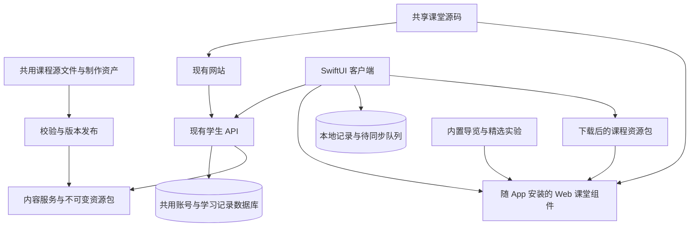

# SystemEdu iOS 架构与数据归属

日期：2026-11-17。状态：方案已进入分阶段实现。本文保留方案制定时的代码调查与设计决策；当前实现与模拟器验证见 [第一批验收](phase1-verification.md)。真机性能与 App Store 审核尚未完成。

## 1. 范围与目标

按整个 SystemEdu 学习平台设计 iOS 客户端，先完成一门课程的端到端体验。用户保留原账号和课程进度；下载后的正文、公式、已适配实验和草稿可以离线使用。网站与 App 使用相同课程来源和学习记录语义。

第一版界面包含“学习 / 探索 / 我的”三个主入口，课堂沿用既有正文富媒体与讲课模式。iPhone 侧重单列阅读与全屏实验，iPad 可并排显示课文和实验。课程编辑、内容生成后台、任意 Python 代码的设备端执行、AR 不列入首版。

## 2. 已核实的现状

以下路径相对于仓库根目录。

| 现有实现 | 可复用内容与限制 |
| --- | --- |
| `packages/student-web/package.json`、`next.config.ts` | Next.js 16、React 19、Three.js、KaTeX、JSXGraph、RDKit。当前不是可直接复制到手机的静态站点；本次未验证全部依赖在 WKWebView 中的兼容性。 |
| `packages/student-web/src/lib/project-lines/load-guided-course.ts` | 部分课程使用服务端 Node 文件系统读取 `public/project-lines/` 下的树、课文和作业。这些源文件需要进入统一发布流水线。 |
| `packages/student-web/src/lib/api/gateway.ts` | 课堂转换逻辑、幻灯片规范化和资源入口有复用价值；其中个人克隆的旧注释不能作为后端当前行为依据。 |
| `packages/student-app/src/systemedu/student/catalog/routes.py` | “加入项目”现在保存数据库关联，课程正文和文件实时代理内容库。`library_version` 不等于可重新下载的固定历史快照。 |
| `packages/library-app/src/library/manifest.py`、`routes/public.py` | 已有版本、文件清单、文件大小、SHA-256 和整包下载机制，应扩展现有清单。 |
| `packages/library-app/src/library/importer.py` | 覆盖导入会删除原项目目录和旧课节行；当前目录内的 archive 也会随覆盖移除。App 离线版本不能建立在“历史包天然永久可取”的假设上。 |
| `packages/student-app/src/systemedu/student/auth/routes.py`、`auth/jwt.py` | 手机验证码登录、新号码按配置注册并要求邀请码，返回 JWT；已查代码没有 refresh-token 接口。App 先兼容已有登录，过期后重新认证。 |
| `packages/student-web/src/lib/api/learning-records.ts`、`learning-record-session.ts` | 草稿版本检查、提交幂等标识、账号隔离和本地恢复已经存在，可共用语义；浏览器 localStorage 和跳转逻辑需要原生适配。 |
| `packages/student-app/src/systemedu/student/learning_records/routes.py` | `expected_revision` 防止覆盖，`request_id` 防止重复提交。请求上限 256,000 字节；目前提交状态为 `ungraded`，不能把上传成功当作合格或已评分。 |
| `packages/student-app/src/systemedu/student/catalog/user_lit.py` | 完成状态支持显式 complete / incomplete，也支持 toggle。离线重试不可使用 toggle，否则重试可能反转结果。 |
| `packages/student-web/src/components/learning/mechanical-hand/`、`mars-landing/` | 适合作为本地 Three.js 适配样本；目前为独立演示，尚未接入正式学习记录。需要抽出资源路径和实验状态接口。 |

根目录的 JavaScript package.json 尚未配置 workspace；共享 TypeScript 包的构建、依赖锁定与网站消费方式属于实施工作，不能仅新增目录就声称已经共享。

## 3. 建议架构

生产 App 通过 URLSession 访问配置的 HTTPS 学生 API；网站现有同源 `/api` 只是 Web 的部署方式。开发、测试、生产地址分开配置，手机不能依赖开发机 `localhost`。不新增独立用户库，也不建立 App 专属课程副本库。

共用的是数据、协议和课堂源码；SwiftUI 界面、Keychain、下载器与系统文件交互由 iOS 实现。现有后端保持主体结构，仅扩展版本资源与确有需要的同步接口。

## 4. 四类存储

### 4.1 服务器：跨端共用的权威记录

| 数据 | 处理方式 |
| --- | --- |
| 用户身份、资料、已加入项目 | 复用学生服务；手机按当前账号保存必要副本。 |
| 课程、题目、资料与资源索引 | 一份源内容，经发布生成不可变 release；网站和 App 使用明确的版本映射。 |
| 正式提交、服务器接受的草稿、完成状态 | 复用学习记录与进度接口。客户端仅显示服务器实际返回的提交及评分状态。 |
| 实验产物、可恢复答案与学习位置 | 小型 JSON 放入现有 artifact / client_context；较大的附件使用独立文件接口，学习记录只存引用。附件接口待设计实现。 |
| AI 会话、知识树、徽章 | 复用现有服务，逐项适配 App；离线显示最后同步副本并标注时间。 |

AI 服务商密钥、数据库凭据、内容制作工具和管理接口均留在服务端或制作环境。API 请求中的用户身份由服务器认证，不能接受课堂页面自报的 user_id。

### 4.2 App 安装包：可离线运行的界面与代码

内置 SwiftUI 界面、课堂 HTML/CSS/JS、KaTeX 与字体、Three.js、已支持的实验逻辑、必要解码器、图标与许可证，以及精选导览与两个模型。JSXGraph、RDKit 等按首发课程需求决定是否编入该版本，不能先承诺所有现有富媒体都能离线执行。

Blender 用于制作，输出 GLB；iOS 加载 GLB，无需安装 Blender。源 `.blend`、制作脚本、课程生成工具不进入安装包。若手机模型需要减面或压缩，生成带来源哈希的移动端派生资产，网站和 App 仍可选择同一发布清单中的不同质量档。

2026-11-17 本地文件测量（十进制 MB）：机械手 GLB 4,364,628 字节，火星着陆 GLB 2,291,848 字节；两张原始 poster 合计 3,284,288 字节。合计 9.94 MB，不含引擎、字体、原生二进制和压缩差异。初步目标为精选资源不超过 15 MB、安装产物不超过 150 MB；这是待真机构建测量的预算，不是现有结果。

### 4.3 下载目录：用户选择保存的课程

- `Library/Application Support/ContentPacks/<slug>/<release_id>/`：完整且校验通过的离线包。用户明确下载的内容不放在系统可随时清理的 Caches 中。可重新获取的资源标记为排除备份。
- `Library/Application Support/DownloadStaging/`：未完成下载，校验成功后原子切换；标记排除备份。中断可续传，服务端不支持续传时安全重下。
- `Library/Caches/`：可重新获取的目录封面、临时预览和缩略图，按空间预算淘汰。
- 旧版本在仍有未同步记录或恢复依赖时保留；删除课程下载与退出课程是两个不同操作，前者不得删除学习记录。

Apple 区分可清理缓存与用户预期持久可用的下载文件，并提供排除备份属性；上述目录安排据此设计。[Apple 数据与备份说明](https://developer.apple.com/documentation/foundation/optimizing-your-app-s-data-for-icloud-backup)

### 4.4 用户本地数据：先落盘，再同步

使用 SQLite 保存草稿、实验状态、阅读位置、待同步请求和同步结果，通过一个串行存储层执行事务并管理 schema 迁移。首次实现采用系统 SQLite3，避免同时引入第二套存储框架。主要表：`drafts`、`outbox`、`reading_positions`、`installed_packs`；记录和未上传附件按账号分区。

用户记录位于 Application Support，与可重新下载内容分开，不因“清缓存”删除；未同步创作不排除备份。用户导出到 Files 的文件经系统分享 / 文件选择流程处理。字体等偏好使用 UserDefaults；JWT 使用 Keychain，退出时清除当前登录凭据，旧账号未同步记录仍隔离保存，重新认证后才能访问或发送。[Apple Keychain 文档](https://developer.apple.com/documentation/security/keychain-services)

游客体验使用独立 guest 分区。登录后迁移游客练习需由用户选择，不能把所有本地草稿自动归入刚登录的人。

## 5. 课程发布与更新协议

在现有 manifest 基础上增加客户端能力信息，具体字段在实施阶段通过 schema 确认：

| 字段 | 作用 |
| --- | --- |
| `release_id`、`schema_version`、`manifest_sha256` | 固定一次发布及清单结构；release_id 不重用、不原地覆盖。 |
| `slug`、`version`、课节与活动映射 | 沿用课程及活动 ID。逐活动保留现有 content_version，不用资源哈希擅自替换记录版本。 |
| `files[{path,size,sha256,media_type}]` | 沿用文件大小与哈希，增加资源类型；路径仅允许包内相对路径。 |
| `runtime_requirements`、`offline_capabilities` | 声明所需阅读器、实验组件、解码器及可离线功能。 |
| `mobile_variants`、`license`、`source_revision` | 移动端资源选择、许可及制作来源。 |

保留现有 latest 接口给网站兼容使用；新增**提议中的**固定版本入口，例如 `/api/my/projects/{slug}/releases/{release_id}/manifest` 和对应文件路径。学生 API 检查项目访问权限再代理内容服务。不可变版本存储独立于会被覆盖的当前项目目录，并为网页恢复旧提交提供按版本读取的入口。

下载流程：取受信 HTTPS 清单 → 检查客户端能力与空间 → 展示下载大小 → 下载临时目录 → 校验长度、哈希、路径与解压体积 → 原子安装 → 更新本地索引。课程更新期间当前阅读使用已固定版本，新版本完整就绪后切换。不会把一半新文件与一半旧文件混用。

首版按课程完整下载，不先做二进制差分。之后根据真实包大小增加按章下载与同哈希资源去重。发布保留周期需覆盖用户记录恢复需求；删除旧包前先检查引用，不能只保留最近两个版本。

现有课程 HTML 可能包含可执行 JS。迁移时必须识别它与普通正文：已编入 App 的交互组件由 JSON 参数驱动；未适配的交互显示说明与在线链接，不能把任意 HTML 当作安全数据接入原生桥。已有学习内容的版本关系仍需保留。

## 6. 同步与恢复

共用记录主键语义：`account_id + library_slug + module_id + activity_id + kind + content_version`。账号 ID 只用于本地分区；服务端身份来自 Bearer token。继续发送既有 `X-Course-Numbering` 协议值，保持旧编号迁移兼容。

1. 编辑答案、改变需要保存的实验状态时，先在同一事务中写本地草稿及待同步动作；高频动画帧不逐帧写入。
2. 恢复网络或回到前台时同步，不依赖 iOS 永久后台运行。后台任务只作为机会性补充。
3. 保存草稿使用现有 `expected_revision`。HTTP 409 时保留本地与远端版本，要求核对，禁止自动覆盖。
4. 提交时固定答案快照、revision 和 request_id。重试复用同一 request_id，得到服务器确认后移出队列；超时不创建新的提交编号。
5. 提交之后的新编辑形成后续草稿，不改变已排队的提交快照。遇到 401 暂停该账号队列，重新认证后续传。
6. 切换账号中止旧账号发送，队列保存 owner 而不是 token；每次发送检查当前认证身份与 owner 一致。旧请求回调只能更新自己的账号分区。
7. 小型实验 JSON 复用 artifact。图片等大附件不能 base64 塞进现有 256 KB 请求；先上传附件并校验归属，再提交引用。首个课程闭环可以先限制为 JSON 产物。
8. 完成状态重试使用 complete / incomplete 显式动作。跨设备撤销和离线阅读位置需要增加版本保护；在接口完善之前只在联网时提交这些状态，离线保存在本机，不以旧离线事件覆盖新的云端状态。

阅读完成、练习自检、正式提交和正式评分分别展示。已有学习记录接口返回 ungraded；合格判定需要明确的服务端验收规则，不能由手机自行上报分数证明。

## 7. 课堂与原生界面的边界

计划定义 `LearningHost` 适配接口：`loadActivity`、`resolveAsset`、`restoreState`、`saveDraft`、`requestSubmit`、`exportArtifact`、`openExternal`。网站实现浏览器/API 适配器，iOS 使用原生桥适配器；课堂不直接持有 JWT、不直接请求任意文件。

消息包含协议版本、会话 ID、活动 scope 和 request_id，由原生端检查活动是否当前已加载、参数类型及大小。只允许本地已打包可信页面调用桥；第三方网站用独立系统浏览视图打开，不共享桥和认证信息。恢复时先加载对应资源版本再注入状态。

资源服务优先验证 WKURLSchemeHandler 自定义本地 scheme，限定可读目录、MIME 与取消请求行为。GLB、字体、WASM、跨源加载和视频 Range 请求需逐项做真机验证；媒体优先交给原生播放器。Apple 提供该协议处理 WebKit 不原生处理的 URL scheme，但这不自动保证所有教学依赖兼容。[WKURLSchemeHandler](https://developer.apple.com/documentation/webkit/wkurlschemehandler)

Three.js 场景需要暂停后台渲染、限制像素比、在关闭时释放 GPU 资源，能处理 WebGL context loss。实验恢复保存关节角度、目标、随机种子或动画阶段等有意义状态；不直接序列化整个 Three.js 场景。

## 8. 决策记录

### ADR-001：SwiftUI + 本地课堂组件（Proposed）

**背景：** 已有大量 React / HTML / Three.js 课堂，需要原生下载、可靠本地保存和移动交互。

**决策：** 原生应用导航与设备服务，复用经解耦的本地 Web 课堂。

**备选：** Capacitor 更利于继续使用 React 做外层界面，但当前 Next 服务端加载仍需拆分；全 SwiftUI / RealityKit 将重写公式、图表和 GLB 交互；整站远程 WebView 难以提供稳定离线体验。

**代价：** 维护 Swift 与 TypeScript 两种语言、原生桥协议及两端回归测试。先抽课堂核心，不一次重构整个网站。

### ADR-002：同源课程 + 不可变版本包（Proposed）

**背景：** 当前服务器主要代理最新课程，导入会覆盖旧文件；用户可能离线数日。

**决策：** 从同一课程源生成网站和 App 可读发布物，增加按 release 读取及历史保留，沿用活动标识。

**备选：** App 单独复制课程会形成内容分叉；只下载最新文件无法保证旧答案和旧题目对应。

**代价：** 增加资源存储、版本索引与发布校验；优先复用现有 manifest 和文件服务，不引入新微服务或独立业务数据库。

### ADR-003：本地事务保存 + 服务端版本确认（Proposed）

**背景：** 手机网络不稳定，多设备同时编辑会冲突；后端已有 revision 与 request_id。

**决策：** SQLite 草稿与 outbox 事务保存，复用服务端并发控制，必要时人工核对冲突。

**备选：** 只在线保存无法保证途中离线学习；无条件最后写入覆盖会丢答案；完整 CRDT 对当前表单和实验快照过重。

**代价：** 需要队列状态、迁移与错误恢复测试；界面必须区分本机保存、同步成功、正式提交。

### ADR-004：渲染代码随 App，内容按需更新（Proposed）

**背景：** 课程同时包含正文数据、媒体资源与可执行交互脚本。

**决策：** 首版将可执行课堂引擎和已支持实验打包，远程主要更新正文、参数及媒体。引擎能力新增随 App 发布。Python / AI 等在线能力独立评估，不默认下载执行器。

**备选：** 动态下载课程脚本可更快增加实验，但会增加审核、版本与原生权限边界的复杂度。Apple 2.5.2 与 4.7 有不同适用规则，不能概括为所有 JavaScript 下载都禁止；本方案选择较明确的代码/内容边界。离线功能和原生体验也对应 4.2 的要求。[App Review Guidelines](https://developer.apple.com/app-store/review/guidelines/)

**代价：** 新类型实验需要 App 更新；旧客户端应保留静态说明和明确的升级提示。

### ADR-005：共用内容和实验核心，独立手机交互（Implemented for bundled previews）

**背景：** 首批技术验证复用了整个网页查看器，手机上需要长距离滚动才能找到控制，宽表格依赖横向拖动。

**决策：** 网站保留现有 viewer；App 入口使用 `learning-runtime/src/mobile/`。共用 GLB、场景生命周期、运动学、阶段资料、Markdown 及快照字段，分别组织桌面和手机控制。模型与主操作同屏；详细解释在可关闭弹层内；课文按语法节点翻页；表格按行生成带完整字段名称的卡片。窄屏标题采用简短显示文案，目录保留原题。

**取舍：** 手机视图有独立的界面代码和验收矩阵，但不用复制算法或另写课程。短横屏的辅助数值并入“动作原理”，其入口保持可见；长说明和放大文字允许局部滚动，不能裁掉内容。

**兼容：** 原活动 ID 和状态字段保持可读；阅读新增 `reader_page`，旧笔记默认从第一页打开。当前页 ID 只适用于内置的课程 1.0 fixture；课程更新时须按内容版本解析，不能把页序号当知识点或完成状态。

## 9. 验证目标与发布前缺口

以下均为待验证目标：精选实验在最低支持真机上可持续操作，优先达到 30 FPS；不因反复进入退出实验出现持续内存增长；飞行模式冷启动可阅读内置导览；下载完整的课程可恢复草稿；字号放大与 VoiceOver 可操作核心控件，3D 附带文字说明和可访问参数控件。

主要风险是 WebKit/WASM 兼容、GPU 内存、历史资源缺失及跨设备同步。阶段 1 用真机验证渲染，阶段 2 建版本包，阶段 3 做故障恢复矩阵。CDN 可按流量增加，首版不建立新的运维服务；新增成本主要是版本资源存储、下载流量、Mac 构建和设备测试。

App Store 准备需落实 Apple 开发者团队与签名、隐私说明、账号删除流程及线上依赖的可用性。现有短信验证会注册新账号，而已查 auth 路由没有账号删除接口，应作为发布前功能缺口补齐。YouTube 等外部媒体首版只提供合法在线入口，不作为离线下载资源。对应规则参见 [Apple 5.1.1 与 5.2.3](https://developer.apple.com/app-store/review/guidelines/)。第一批开发不上传 TestFlight、不部署服务、不提交商店。
